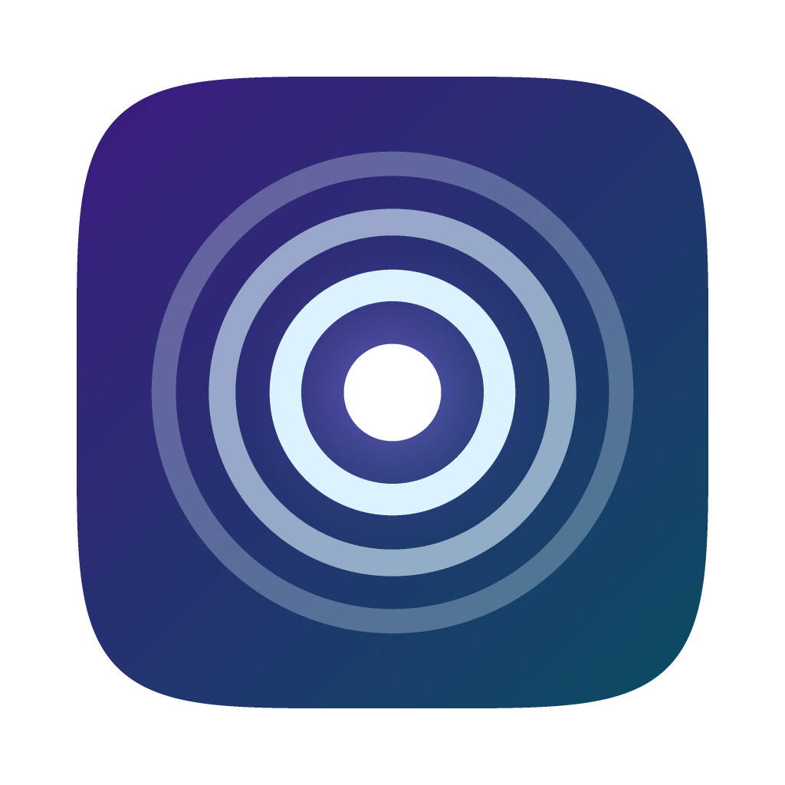

<p align="center"></p>

# Resona

**A local-first networking agent for your Mac.** Resona reads the project folders you choose, finds people talking about problems your work already solves, and drafts useful replies, follow-ups and posts for you to review. Everything it learns stays on your Mac, and nothing is ever sent without you.

Built for students and early-career people who want to be known for their work, not for cold outreach.

> **Status:** working prototype. Runs as a Mac app (Apple Silicon) or in the browser for development. LinkedIn search is not available yet (see [Not built yet](#not-built-yet)).

## What it does

1. **Understands your projects.** Add local folders. Resona summarizes what each project does, what you contributed and what it achieved, and asks you about anything unclear. Folders are re-checked when they change.
2. **Finds relevant conversations.** It searches GitHub, Hacker News and X with your project context, or you paste a post yourself. Each match is scored by how useful your work is to that person, not just by shared keywords.
3. **Drafts, you decide.** Every opportunity comes with the source post, a "why you" explanation with file references, and an editable draft. You approve an exact version, copy it, post it yourself, and mark it sent.
4. **Grows your network.** A 3D map of the people you know, placed closer the stronger the connection. Click someone to see shared projects, conversations and what to follow up on.

Also: LinkedIn/X post drafts from meaningful project changes, follow-up reminders, a LinkedIn data-export import, ⌘K search across people and content, and a weekly review.

## Install the Mac app

Download `Resona-<version>-arm64.dmg` from [Releases](https://github.com/Sonicnik/resona/releases). It runs on Apple Silicon Macs.

Resona isn't signed with a paid Apple Developer ID, so macOS blocks it the first time:

1. Open the DMG, drag **Resona** to **Applications**, open it, and close the warning.
2. Open **System Settings → Privacy & Security**, scroll down, click **Open Anyway** next to Resona, and enter your Mac password.
3. If macOS says Resona "is damaged and can't be opened", run this in Terminal and open it again:

   ```bash
   xattr -cr /Applications/Resona.app
   ```

You do this once per version. When a new version is published, Resona shows **Download Resona x.y.z…** in its menu bar icon.

### First steps

1. **Connect AI** in **Privacy**: **Continue with ChatGPT** uses your ChatGPT Plus or Pro plan, or **Claude → Connect** takes an Anthropic API key. Without either, Resona still works offline with simpler summaries and template drafts.
2. **Add project folders** with **+** or **File → Add Project Folder…** (⌘O).
3. **Allow AI per folder** in **Privacy**. Folders start with AI off.
4. **Scan for Opportunities** from **Opportunities** or the menu bar icon.

Resona lives in the menu bar: closing the window keeps the agent working in the background, and you get a notification when new opportunities arrive. **Quit Resona** (⌘Q or the menu bar icon) stops it. Turn on **Open Resona at login** in **Privacy** to keep it running.

## Privacy

- **Your data stays local.** The database and an Obsidian-compatible Markdown vault live in `~/Library/Application Support/Resona`.
- **AI is opt-in per folder.** Only selected excerpts from allowed folders are sent to the AI provider you connected. Credentials, dependencies, build output and anything in `.gitignore` are always excluded, and you can add your own exclusions.
- **You can see what left your Mac.** **Privacy → What left this Mac** lists every request: which files, how many characters, which model.
- **Keys stay in the Keychain.** API keys and ChatGPT sign-in tokens are stored in the macOS Keychain, never in the database, the vault or this repository.
- **Nothing is sent for you.** Resona never posts or messages anyone. Editing a draft after approving it requires approving it again.

## Develop

Needs Node 22.13 or newer.

```bash
./start.sh
```

This installs what's missing, starts the backend on demo data (seeded once into `~/.resona-demo`), and opens http://localhost:1420. Ctrl+C stops everything. `./start.sh --real` uses your real data instead.

| Folder | What's in it |
| --- | --- |
| [`app/`](app/) | The UI: React + Vite, the glass "star map" design ported from [`design/prototype.html`](design/prototype.html). |
| [`backend/`](backend/README.md) | Local API on `127.0.0.1:4317`: TypeScript, built-in `node:sqlite`, Markdown vault, Claude and ChatGPT gateway. [API reference](backend/docs/api-reference.md). |
| [`desktop/`](desktop/README.md) | The Mac app: Electron shell, menu bar agent, DMG packaging and releases. |
| [`docs/`](docs/) | [Product reference](docs/product-reference.md), [Mac app plan](docs/MAC_APP_PLAN.md) and [progress notes](docs/PROGRESS.md). |

| Task | Command |
| --- | --- |
| Backend tests | `cd backend && npm test` |
| Typecheck | `npx tsc --noEmit` in `backend/` and `app/`; `npm run typecheck` in `desktop/` |
| Run the Mac app from source | `cd desktop && npm install && npm start` (stop `./start.sh` first) |
| Build the DMG | `cd desktop && npm run dist` → `desktop/dist/` |
| Publish a release | See [desktop/README.md](desktop/README.md#release-a-new-version) |

## Not built yet

- **LinkedIn search.** It needs authorized access; until then, paste LinkedIn posts with **Add Post** or import your LinkedIn data export.
- **Posting for you.** Sending is copy-and-paste on purpose.
- **PDF and DOCX reading.** These files are skipped for now.
- **Tailored CVs (phase 2).** A master career record built from your projects, then CVs generated for each application.
- **Tighter matching.** A scan can still add many weak opportunities.
